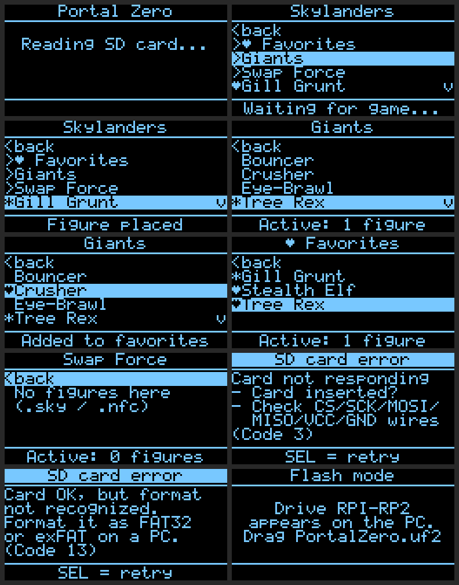

# Portal Zero

**A Skylanders portal emulator for the Wii – RP2040-Zero, 3 buttons, OLED, SD card.**

A **Waveshare RP2040-Zero** pretends to be an original **Skylanders Portal of Power** on the **Nintendo Wii**.
Figures are stored as files on an SD card and are "placed" on the portal using a small OLED display and three buttons.

> Based on [NicoAICP/PTPE](https://github.com/NicoAICP/PTPE) – rebuilt for **3 buttons**, an **I²C OLED**,
> a fully implemented **portal protocol** and direct support for **Flipper Zero `.nfc` files**.



---

## Features

- 🎮 **Skylanders portal for the Wii** – identifies itself like the original (Activision "Spyro Porta", VID `1430` / PID `0150`)
- 🧩 **Up to 16 figures at once** on the portal
- 📁 **Folder navigation** on the SD card – e.g. sort figures by game
- ♥ **Favorites** – long-press SEL on a figure to mark it as a favorite; all favorites are collected in the "♥ Favorites" folder at the top
- 🔖 **Remembers the last figures** – they are back on the portal automatically the next time you switch on (one small hidden file `.portalzero_last`, only rewritten when something changes)
- 📄 **Reads Flipper Zero `.nfc` directly** – no conversion needed, only the hex blocks are sent to the Wii
- 💾 **Saves game progress** – level, gold, upgrades are written back into the file automatically (also into `.nfc`; header lines and keys stay unchanged)
- 🛡️ **Safe against power loss** – saving goes through a temporary file, leftovers are cleaned up on the next start
- ⚡ **Ready instantly** – announces itself as a portal right after plugging in, the SD card is read afterwards
- 🧠 **USB on its own CPU core** – the Wii is always served immediately, even while saving to the SD card
- 🔁 **Behaves like the real portal** – figures are re-announced when the game (re-)activates the portal, the same figure gets its old slot back
- 🔧 **Flash mode without a BOOTSEL button** – the case can stay closed (4 ways, see below)
- 🔤 Umlauts and accents in file and folder names are shown readably

Made for the Skylanders games on the **Wii**, e.g. **Spyro's Adventure** and **Giants**.

### Console compatibility

The Wii, Wii U, PS3 and PS4 portals are interchangeable – Portal Zero emulates exactly this portal. Only the Xbox portals are console-specific.

| Console | Status |
|---|---|
| **Wii** | ✅ tested |
| **Wii U, PS3, PS4** | 🟡 expected to work (same portal and protocol), not tested yet – feedback welcome |
| **Xbox 360 / Xbox One** | ❌ not supported (Xbox uses its own portals) |
| **Switch** | ❓ unknown |

---

## Hardware

| Part | Note |
|---|---|
| Waveshare RP2040-Zero | USB-C, GPIO 0–15 and 26–29 are used |
| OLED 0.96" SSD1306, 128×64, I²C | 4 pins: VCC, GND, SCL, SDA |
| SD card module (SPI) | card formatted as FAT32 or exFAT |
| 3 push buttons | UP, SEL, DOWN |
| USB-C **data** cable | not a charge-only cable |

### Wiring

The pin names (GP…) are printed on the RP2040-Zero.

**OLED (I²C0)**

| OLED | RP2040-Zero |
|---|---|
| VCC | 3V3 |
| GND | GND |
| SDA | GP28 |
| SCL | GP29 |

I²C address `0x3C` – if the display stays dark, change it to `0x3D` in `oled.h`.

**SD card module (SPI1)**

| SD module | RP2040-Zero |
|---|---|
| CS | GP9 |
| SCK / CLK | GP10 |
| MOSI | GP11 |
| MISO | GP12 |
| GND | GND |
| VCC | 5V (module with voltage regulator) **or** 3V3 (plain 3.3 V module) |

> SCK must be on **GP10** and MOSI on **GP11** – the RP2040's hardware SPI only allows this combination on these pins.

**Buttons** – each button goes between a **GPIO** and **GND**. The firmware uses the internal pull-up, so no resistors are needed.

| Button | Leg 1 | Leg 2 |
|---|---|---|
| UP | GP8 | GND |
| SEL | GP7 | GND |
| DOWN | GP6 | GND |

All three buttons can share one GND wire. It doesn't matter which leg goes to the GPIO and which to GND.

**To the Wii:** USB-C cable from the RP2040-Zero into a USB port at the back of the Wii. Power comes over USB.

---

## Figures on the SD card

Copy figures into the **`Skylanders`** folder (created by the board on first start). Subfolders are allowed.

```
SD card
└── Skylanders
    ├── Spyro's Adventure
    │   ├── Spyro.nfc
    │   └── Gill Grunt.nfc
    └── Giants
        └── Tree Rex.nfc
```

Supported formats:

- **`.nfc`** – Flipper Zero dumps (MIFARE Classic 1K). Only the lines `Block 0:` … `Block 63:` are used, everything else is ignored. `??` in the key blocks is normal; if data is missing, the display shows "Warning: incomplete".
- **`.sky` / `.bin` / `.dmp`** – raw data with exactly 1024 bytes.

> ⚠️ This repository contains **no figure files**. Please only use dumps of your own figures.
> Make a backup of your files before playing for the first time – the game writes directly into them.
>
> Coming from the older PTPE firmware? Your favorites and last figures are taken over automatically from the same SD card.

---

## Controls

| Button | Function |
|---|---|
| **UP / DOWN** | select an entry (hold = scroll fast) |
| **SEL short** | open folder `>` · back `<` · place / remove figure (`*` = on the portal) |
| **SEL long (1 s) on a figure** | add to / remove from favorites (♥ in front of the name) |
| **SEL long (1 s) on a folder** | reload the SD card (e.g. after swapping cards) |

The footer shows the status: `Wii not connected` → `Waiting for game...` → `Active: 2 figures`.

**Tip for USB Loader GX:** if the portal is not found, go to the Wii Menu first and start the loader from there.

---

## Flash mode without a BOOTSEL button

So the case can stay closed, there are four ways into flash mode. Afterwards the drive **RPI-RP2** appears on the PC – just drag the new `PortalZero.uf2` onto it.

1. **Hold SEL while plugging in** – checked before anything else, so it also works if the display or SD card has problems.
2. Hold **UP + DOWN for 3 seconds** at the same time (while running).
3. Put an empty file named **`BOOTSEL.txt`** into the root of the SD card and start the board (the file is deleted automatically).
4. **From the PC:** `pip3 install hidapi`, then `python3 tools/portalzero_flash.py`

The very first time, use the BOOT button on the RP2040-Zero (hold BOOT while plugging in).

---

## Flashing the firmware

Download `PortalZero.uf2` from the [releases](../../releases), put the board into flash mode and drag the file onto the **RPI-RP2** drive.

## Building it yourself

Tested with **Pico SDK 1.5.1** (SDK 2.x does not work without further changes). The SD card library is already included – nothing needs to be copied into the SDK.

```bash
git clone -b 1.5.1 https://github.com/raspberrypi/pico-sdk.git ~/pico-sdk-1.5.1
cd ~/pico-sdk-1.5.1 && git submodule update --init

cd PortalZero
export CMAKE_POLICY_VERSION_MINIMUM=3.5      # only needed with CMake 4
PICO_SDK_PATH=~/pico-sdk-1.5.1 cmake -S . -B build -G Ninja
cmake --build build
```

Output: `build/PortalZero.uf2` (and `build/SDTEST.uf2`, a plain SD card test program for troubleshooting).

**VS Code:** extension "Raspberry Pi Pico" → *Import Project* → choose SDK version **1.5.1** → *Compile*.

---

## Troubleshooting

| Display | Cause / fix |
|---|---|
| `SD card error (Code 3)` | card not responding – card inserted? wires CS/SCK/MOSI/MISO/VCC/GND OK? |
| `SD card error (Code 1)` | read error – MISO/MOSI swapped or loose contact |
| `SD card error (Code 13)` | format not recognized – format the card as FAT32 or exFAT |
| `Invalid file` | not a 1K figure (e.g. NTAG/Amiibo) or incomplete dump |
| `Wii not connected` | check the data cable, try the other USB port |
| Display stays dark | SDA/SCL swapped or I²C address `0x3D` |
| A button does nothing | check that it is wired to the right GPIO and to GND (see table above) |

`SDTEST.uf2` only talks to the SD card and shows the result every second – this cleanly separates a hardware problem from the firmware.

---

## Project structure

| File | Content |
|---|---|
| `main.c` | main loop, buttons, saving, flash mode |
| `portal.c` | Skylanders portal protocol (A/R/S/Q/W/C/J/L/M) |
| `figures.c` | folder browser, favorites, loading and safe saving |
| `nfc.c` | read and write back Flipper `.nfc` |
| `menu.c`, `oled.c` | screen output and SSD1306 driver |
| `usb_descriptors.c` | USB identification as a portal |
| `hw_config.c` | SD card pins |
| `tools/` | `portalzero_flash.py`, `nfc2sky.py`, `sdtest.c` |

---

## Credits

- [NicoAICP/PTPE](https://github.com/NicoAICP/PTPE) – original project this is based on (Pico Toy Pad Emulator)
- [no-OS-FatFS-SD-SPI-RPi-Pico](https://github.com/carlk3/no-OS-FatFS-SD-SPI-RPi-Pico) – SD card driver (Apache 2.0)
- [TinyUSB](https://github.com/hathach/tinyusb) – USB stack (MIT)
- The portal protocol follows the Skylanders portal emulation of the Wii emulator [Dolphin](https://github.com/dolphin-emu/dolphin)

Skylanders is a trademark of Activision. This project is not affiliated with Activision or Nintendo.
